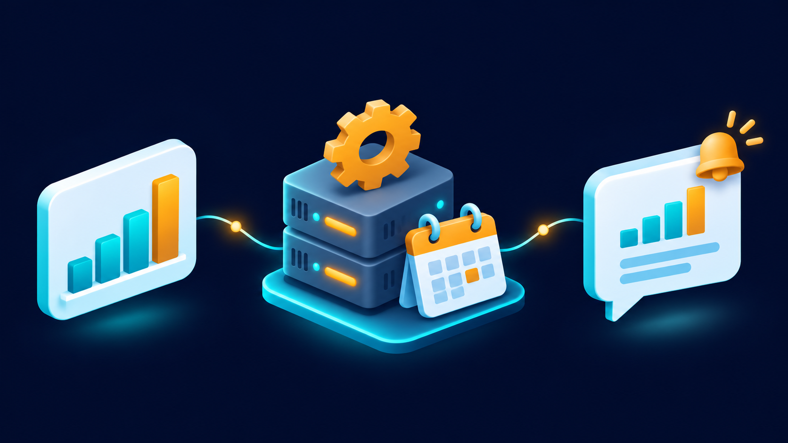

# Google Analytics & Ads AI

### Free Google Analytics and Google Ads insights in Codex and Claude Code

**Free, open-source tools for connecting your Google Analytics 4 and Google Ads data to Codex or Claude Code.** Ask questions in everyday language, explore performance, and compare recent periods using your own accounts.

The project runs the two separate official Google MCP servers on your computer and connects them to your AI client. The supplied AI configuration exposes **read-only** tools. Your credentials stay in private files you control; the assistant can receive the data you ask it to retrieve, so follow your organization’s privacy rules.

The project itself is free and open source. Google Cloud, Google Ads, your AI provider, hosting and other external services may have their own charges, quotas, access requirements or terms. This independent project is not affiliated with or endorsed by Google.

## What can I ask?

- “Which landing pages received the most sessions in the last seven complete days?”
- “Show active Google Ads campaigns and compare the last 3 and 7 complete days with the preceding equivalent periods.”
- “Compare Google Ads performance with GA4 landing-page traffic and explain differences in attribution.”

Use the [ready-to-copy scenarios](scenarios/README.md) for fuller instructions. Results depend on the data, account permissions, configuration, Google API access and your AI client. GA4 events are not necessarily purchases, and Ads and GA4 metrics may use different attribution, time zones and currencies; see [how to interpret results](docs/DATA_INTERPRETATION.md).

## Get started

**Using the Codex or Claude Code plugin?** Follow the [plugin installation guide](plugins/flai-google/README.md) for client-specific setup. The direct MCP connection below is also available.

1. Install **Codex or Claude Code**, Python 3.11+, Git and Google Cloud CLI on your computer.
2. In your own Google Cloud project, enable the required APIs and obtain access to your GA4 property and Google Ads account. Google Ads production access may require a separate application.
3. Follow the [step-by-step setup](docs/MCP_SETUP.md) to install the project, sign in to Google, create a private profile and connect your chosen AI client.
4. Ask the client to identify your accounts and list the available tools. Check the IDs, time zones and currency before relying on a report.

The setup uses local stdio processes and requires the client to run on a machine that can access the installed files and private credentials. You do **not** need Slack, Docker, a VPS or a schedule to ask questions in an AI client. The instructions currently cover macOS and Linux; Windows users need equivalent paths and permissions.

## Safety and limitations

The AI connection is configured for reading. The Google Ads OAuth scope itself can permit changes; restrict the Google account’s permissions and protect the credentials. The repository does not provide general campaign, budget or bid changes. A separate experimental label-creation utility is described in the [setup guide](docs/MCP_SETUP.md#optional-create-one-ads-label-with-explicit-confirmation); it is not part of the default AI connection and requires further policy and end-to-end verification before real use. See [Google Ads policy notes](docs/GOOGLE_ADS_POLICY.md).

These are Google's independently distributed [Analytics MCP](https://github.com/googleanalytics/google-analytics-mcp) and [Ads MCP](https://github.com/googleads/google-ads-mcp), both Apache-2.0 licensed; consult those projects for their licenses and notices. Google Analytics and Google Ads are Google trademarks.

## Optional: scheduled reports to Slack

Want a GA4 landing-page report delivered automatically? The separate [Slack reporting guide](docs/SLACK_REPORTING.md) explains configuration, alerts, delivery recovery and updates. It requires Slack, Docker and a computer or server that is running at the scheduled time. It reports GA4 only and does not use the AI MCP connection. This option is entirely optional.

## Development

Run `python -m unittest discover -s tests` after installing the project. Automated tests use synthetic data and mocks; successful tests do not prove access to your Google accounts or delivery to Slack. See [LICENSE](LICENSE).
