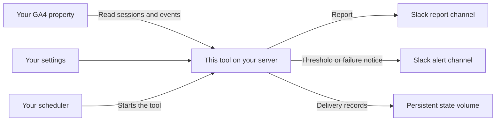

# Optional: scheduled GA4 reports to Slack

[← Back to the main README](../README.md)

## Scheduled GA4 reports to Slack

This self-hosted tool compares two equal periods and posts a report to Slack. You choose the pages, the event to count, and alert thresholds.

## What your team receives

For each page you list, the report shows:

- **Sessions:** how many GA4 sessions started on that landing page.
- **Events:** how many times your selected event was counted by GA4, grouped by `landingPage`.
- **Comparison:** the latest complete period against the immediately preceding period of the same length.
- **Alerts:** a separate Slack message when a configured percentage-change threshold is crossed. The tool also attempts a failure notification if a scheduled run fails.

**Example — made-up numbers:** if the window is 7 days and the run occurs on 15 January, the report compares 8–14 January with 1–7 January. It might show:

```text
GA4 landing report: 2027-01-08–2027-01-14 (America/New_York)
Previous: 2027-01-01–2027-01-07
Event: Contact button clicks (contact_click)

Spring offer (/spring-offer): sessions 80 vs 120; events 25 vs 40
```

If you set a 30% decrease alert with a minimum previous value of 100 sessions, this example produces an alert: sessions fell from 120 to 80, a decrease of 33.3%. If the previous value is zero, no percentage alert is sent because there is no comparison base.

**Important:** `eventCount` counts event occurrences, not unique people or unique converting sessions. The event could occur on a later page; its appearance under a `landingPage` does not prove it occurred on the landing page. A click is not a confirmed sale. The tool deliberately does not calculate conversion rate from `eventCount`.

## How it works



The schedule is configured **on your machine**, not inside the tool. The tool stores delivery records so it can avoid posting the same report again. If a send has an uncertain outcome, it stops for a person to check rather than automatically posting a duplicate.

---

## Before you start

You will need:

1. **GA4:** a property that already receives data, its numeric property ID, and permission to grant a service account access. Your event must already be configured in GA4. To find the ID, open **Admin → Property settings → Property details** in Google Analytics. Note the property's reporting time zone, too. The numeric property ID is different from a `G-...` measurement ID. Google may change menu labels; see its [property details guide](https://support.google.com/analytics/answer/9304776).
2. **Google Cloud:** a project in which the **Google Analytics Data API** is enabled, plus a service account with read access to the GA4 property. You will create a JSON key for the service account.
3. **Slack:** permission to create or install an app and add it to the report and alert channels.
4. **A host:** Docker with the Compose plugin, Git, an internet connection, and a place to keep the host running on schedule. Linux is recommended for the scheduling example below. Ask your administrator for help if needed.

Your Google and Slack accounts may require administrator approval. The host needs access to Google and Slack; a laptop that is off or asleep cannot run scheduled jobs.

## Step 1 — Give the tool read access to GA4

1. In [Google Cloud Console](https://console.cloud.google.com/), select an existing project or create one.
2. Open **APIs & Services → Library**, find **Google Analytics Data API**, and enable it for that project.
3. Open **IAM & Admin → Service Accounts** and create a dedicated service account. Copy its email address; it looks like `name@project.iam.gserviceaccount.com`.
4. In Google Analytics, open **Admin → Property access management** for your intended property. Add that service-account email with the **Viewer** role. Google Cloud project access alone does not grant access to your GA4 property.
5. In Google Cloud, open the service account's **Keys** section and create a **JSON** key. Store the file securely on the host, **outside this repository**. Treat it like a password: anyone who obtains it may be able to read the data available to that service account. Some organizations disable service-account keys; if so, ask your administrator for an approved credential method.

Google's [official Data API quickstart](https://developers.google.com/analytics/devguides/reporting/data/v1/quickstart) covers enabling the API and service-account access.

## Step 2 — Create a Slack app

1. Open [Your Slack Apps](https://api.slack.com/apps) and create an app in your team's workspace. An administrator may need to approve it.
2. In **OAuth & Permissions → Bot Token Scopes**, add **`chat:write`**. Install the app to the workspace and approve the requested access.
3. Copy the **Bot User OAuth Token** into a secure place for the next step. Do not paste it into a public issue, a commit, or a chat message.
4. In Slack, invite the app to the channel where reports should appear. If alerts go to a different channel, invite it there too. In each channel, open its details and copy its **channel ID**.

Use a dedicated app with access only where needed. An app is not automatically able to post to an existing group direct message; start with a regular test channel and verify the destination. Slack's [app setup guide](https://docs.slack.dev/app-management/quickstart-app-settings/) explains scopes and installation.

## Step 3 — Install the project

Open a terminal on the machine that will run the reports:

```sh
git clone https://github.com/FlaiData/ga4-landing-reports.git
cd ga4-landing-reports
cp config.example.json config.json
cp .env.example .env
chmod 600 config.json .env
```

These commands create two **private local files** from examples. The examples contain placeholder data only. Do not upload your completed `config.json`, `.env`, service-account key, generated reports, or delivery state to GitHub.

Check that Docker is running:

```sh
docker --version
docker compose version
docker info
```

If `docker info` cannot connect, start Docker Desktop or the Docker service on your host, then try again. If your user cannot access Docker, ask your administrator for access rather than running the project with broad file permissions.

## Step 4 — Enter your settings

Open `config.json` in a text editor. Keep JSON syntax: strings need double quotes, entries need commas, and the final entry in a list must not have a trailing comma. The supplied `config.example.json` shows a complete example.

| Setting | What to enter |
| --- | --- |
| `report_id` | A short stable name such as `landing-pages`. Keep it unchanged when editing labels, pages, event names or rules. Changing it creates a new delivery identity. |
| `property_id` | Your **numeric GA4 property ID as a string**, for example `"123456789"`. Replace the example. |
| `timezone` | The IANA time zone of your GA4 property, for example `America/New_York`. It must match the property's time zone. |
| `days` | Number of complete days in **each** period, from 1 to 365. `7` compares the latest 7 complete days with the preceding 7. |
| `paths` | Pages to include. A URL such as `https://example.com/spring-offer?utm_source=...` becomes `"/spring-offer"`. Give each path a label. Paths must be unique and have no query string or fragment. |
| `event_name` | The exact existing GA4 event name, such as `contact_click`. Use only letters, digits and underscores. |
| `event_label` | A readable label, such as `Contact button clicks`. |
| `slack_channel_id` | ID of the report channel, as a string. |
| `alert_channel_id` | ID of the alert channel; it may be the same as the report channel. This field is required even if you turn off threshold alerts. |
| `alert_rules` | Rules for `sessions` or `events`: direction `increase` or `decrease`, percentage and `min_previous`. Use `[]` for no threshold alerts. Failure-notification attempts remain enabled. |
| `state_dir` | Use `/data` with the supplied Docker Compose setup. This is where delivery records are kept. |

**Scope of data:** the tool queries the entire GA4 property. If several sites or data streams have the same landing path, their data can be combined. Stream/hostname filtering and automatic page discovery are not implemented. Include all relevant paths yourself and use a property whose scope matches the report. The tool does not verify that a configured path or event name exists: a typo, wrong case or unmatched path can look like a zero. Check names and dates in GA4 before enabling alerts.

Next, open `.env` and replace the placeholders:

```dotenv
GA4_CREDENTIALS_FILE=/absolute/path/to/your-service-account.json
SLACK_BOT_TOKEN=your-slack-bot-token
```

The second line is a placeholder: replace it with your real token in the local file only. The credential file and `.env` must be readable only by trusted administrators. The container runs as **UID 10001** and must be able to read **both** `config.json` and the mounted credential file. On a standard Linux host with filesystem ACL support and without user-namespace remapping, an administrator can grant that one UID read access while retaining the files' restrictive permissions:

```sh
sudo setfacl -m u:10001:r config.json
sudo setfacl -m u:10001:r /absolute/path/to/your-service-account.json
```

Replace the example path with the real key path. `setfacl` may need to be installed, and rootless Docker or user-namespace remapping can map container IDs differently; ask your administrator to adapt the ACL or ownership for your host. Do not make either file world-readable. The `.env` file is read by Compose on the host and does not need to be mounted into the container.

## Step 5 — Preview and verify

Build the image, then prepare a report **without sending a Slack message**:

```sh
docker compose build
docker compose run --rm --entrypoint sh report -c 'test -r /app/config.json && test -r /run/secrets/ga4-credentials.json && echo "Both files are readable"'
docker compose run --rm report --preview
```

The preview makes live, read-only GA4 requests. It prints the report and any threshold alerts in the terminal. Compare the period, page paths, sessions and event counts with GA4 for the same dates and property time zone. Verify what your event actually measures.

The tool refuses sampled, thresholded, truncated, restricted or otherwise incomplete responses it detects, and refuses a mismatch between the configured and GA4 property time zones. These checks do not prove that all tracking is correct or that all data has arrived; GA4 can revise recent data after a day ends.

## Step 6 — Send a first report

When the preview is correct and the app has access to the destination, send **one real report**:

```sh
docker compose run --rm report
```

Open the intended Slack channel and confirm the complete message arrived. A successful preview alone does not verify Slack delivery. If the report is split into parts, later parts are replies in the same thread. The tool sends a separate message to the alert channel only when a configured threshold is crossed.

The named Docker volume `report-state` stores delivery records. Keep it when rebuilding or updating. For the same report ID, property, window and channel, a successfully sent report is not sent again merely because its text or page labels changed. Changing the report ID, property, time zone, window length, or destination creates a different identity and may result in another message. Separate installations with separate state can also send duplicates.

## Step 7 — Schedule the reports on Linux

The tool does not create its own schedule. The example below uses **systemd**, common on Linux servers, to run on Mondays and Thursdays at 09:00 in `America/New_York`. The schedule's time zone is separate from the GA4 property's time zone. Replace `/srv/ga4-landings` with the **absolute path to your actual checkout** in both files. Ask a server administrator if you do not have `sudo` access.

Create `/etc/systemd/system/ga4-landings.service`:

```ini
[Unit]
Description=Landing-page report to Slack
After=network-online.target docker.service
Wants=network-online.target
Requires=docker.service

[Service]
Type=oneshot
WorkingDirectory=/srv/ga4-landings
ExecStart=/usr/bin/docker compose --project-directory /srv/ga4-landings run --rm report
TimeoutStartSec=45min
```

Create `/etc/systemd/system/ga4-landings.timer`:

```ini
[Unit]
Description=Scheduled landing-page report

[Timer]
OnCalendar=Mon,Thu *-*-* 09:00:00 America/New_York
Persistent=true
AccuracySec=1min
Unit=ga4-landings.service

[Install]
WantedBy=timers.target
```

Check the schedule and enable it:

```sh
systemd-analyze calendar 'Mon,Thu *-*-* 09:00:00 America/New_York'
systemd-analyze verify /etc/systemd/system/ga4-landings.service /etc/systemd/system/ga4-landings.timer
sudo systemctl daemon-reload
sudo systemctl enable --now ga4-landings.timer
systemctl list-timers --all ga4-landings.timer
```

`Persistent=true` permits a missed run when the host comes back online. The named time zone follows its daylight-saving rules. Configure **only one scheduler** for the same report, destination and state. macOS and Windows need a separate scheduler; the systemd example does not apply to them.

## Monitoring, alerts and recovery


Check a Linux-hosted run with:

```sh
systemctl status ga4-landings.service --no-pager
journalctl -u ga4-landings.service -n 100 --no-pager
systemctl list-timers --all ga4-landings.timer
```

- **Metric alert:** sent to `alert_channel_id` when a rule crosses its threshold for a configured path. Each rule compares the current period with the immediately preceding period and requires its `min_previous` value. A zero baseline cannot produce a percentage alert.
- **Failure notice:** after a valid configuration is loaded, the tool attempts a short, fixed-category message once per period and error type. It does not include exception details. Check the server journal for the failure stage and error type.
- **Alert limits:** a missing/invalid configuration, unavailable token or state storage, or Slack outage can prevent a failure notice. There is no automatic all-clear or missed-run alert. Use an independent monitor if your team needs reliable notification that the scheduler itself is down.
- **Uncertain Slack send:** first check the destination and the persistent delivery state. A timeout can mean the message arrived even if no confirmation returned. Do not delete state or force a retry until a responsible person has checked which parts arrived and reconciled the record.
- **Permission or time-zone error:** verify the service account has access to the correct property, the Data API is enabled, the credential file is readable by UID 10001, and the configured time zone matches GA4. The journal deliberately does not print sensitive API responses.

For a production setup, have an administrator establish an independent monitoring route, document who checks failed jobs, and test alert delivery in an authorized test channel. To **inspect** delivery records locally without modifying them:

```sh
docker compose run --rm --entrypoint sh report -c 'ls -l /data; for f in /data/*.json; do [ -f "$f" ] && cat "$f"; done'
```

The records contain channel identifiers and delivery timestamps; keep the output private. There is currently no automatic reconciliation command. Ask an administrator to compare the state with Slack and determine a safe recovery; do not edit or delete the records blindly.

## Safe updates for your team

Updates are **not automatic**. On GitHub, choose **Watch → Custom → Releases** if you want GitHub release notifications; maintainers must publish releases for this to notify you. These are different from runtime Slack alerts.

1. Read the release notes and review the changes. Back up your private configuration and the persistent state volume securely. Keep credentials outside source control.
2. Test the reviewed version in a **separate checkout and separate state volume** with `--preview`. Do not post test data to the production channel.
3. Update the production checkout to the reviewed version, rebuild with `docker compose build`, and run another preview. Preserve the original named `report-state` volume and check the Compose project name before changing containers.
4. Verify the timer and next run. Do not remove volumes during routine updates. For a rollback, preserve and reconcile current delivery state so already-posted reports are not repeated.

## Troubleshooting

| What you see | What to check |
| --- | --- |
| Docker cannot connect | Start Docker Desktop or the Docker service and retry `docker info`. |
| GA4 access or authentication error | Enable the Data API; verify the service account's Viewer access to the property, the JSON key path, and permissions on both `config.json` and the key for the mapped container UID. |
| Time-zone or incomplete-data failure | Match `timezone` to the GA4 property; investigate sampling, thresholds or data restrictions before retrying. |
| Slack cannot send | Verify the token, channel ID, workspace, `chat:write` scope and app membership in **both** destination channels. Group DMs have different restrictions. |
| Nothing arrives after a timeout | Check Slack and delivery state before retrying. The tool may be waiting for manual reconciliation. |
| No threshold alert | Confirm the rule's metric, direction, percentage and `min_previous`; a zero previous value has no percentage comparison. |
| A page or event shows zero unexpectedly | Check its spelling, case and path against GA4 for the same period; the tool does not validate that the path or event exists. |

## Data source and trademarks

[](https://www.google.com/analytics/)

The Slack reporter uses the Google Analytics Data API. The optional AI connection runs the separately distributed [Google Analytics MCP](https://github.com/googleanalytics/google-analytics-mcp) and [Google Ads MCP](https://github.com/googleads/google-ads-mcp), both provided by Google under Apache-2.0; see their repositories for licenses and notices. The wordmark above is provided by Google and used subject to the [Google Analytics developer branding guidelines](https://developers.google.com/analytics/terms/branding-policy). Google Analytics and Google Ads are Google trademarks. This independent project is not affiliated with or endorsed by Google.

## Development and verification

For local development, create a Python virtual environment and run `pip install -e .`, then `python -m unittest discover -s tests`. Set `GOOGLE_APPLICATION_CREDENTIALS` to a protected credential file and use a private config with a writable `state_dir`; `python -m landing_reports --config /path/to/config.json --preview` performs a live GA4 read without Slack delivery.

The automated tests use synthetic data and mock network calls. Every new installation needs its own authorized preview, GA4 data check and end-to-end Slack test. See [LICENSE](../LICENSE) for this repository's code license; Google's wordmark remains subject to Google's branding terms.
